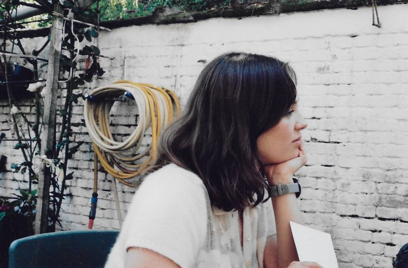

# Sofie Moors

I am a teacher in the [MA Digital Text Analysis](https://www.uantwerpen.be/en/study/programmes/all-programmes/digital-text-analysis/) at the University of Antwerp. Before that, I did a phd in Digital Humanities and Medieval Literature.

I am interested in:

- medieval manuscripts and how they were copied;
- what computers can and cannot read.

This semester I am making a digital edition with the students. You can follow it on [my projects page]().

Contact: sofie.moors@uantwerpen.be